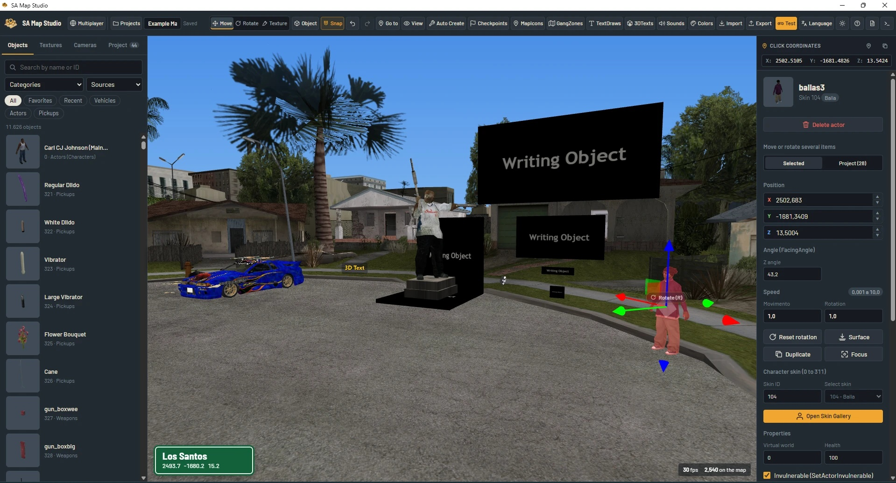

# SA Map Studio

[](https://github.com/Walter-Correa/SA-Map-Studio/releases)


**Map editor for GTA San Andreas: Singleplayer mods, SA-MP and open.mp**: a renewed replacement for the old
*SA-MP Map Construction*, with a new interface and the whole San Andreas map in 3D. Choose **Singleplayer** to build a
mod for the original game (Modloader and CLEO scripts) or **Multiplayer** to generate Pawn code for your server.

The editor reads the files straight from your GTA San Andreas folder, without changing anything in the game. In
Multiplayer it generates Pawn code ready to paste into your gamemode or filterscript; in Singleplayer it generates a mod
folder for the Modloader (the game's own files are never changed).

---



## Contents

- [Features](#features)
- [How to use](#how-to-use)
- [Building the program](#building-the-program)
- [The program folder](#the-program-folder)
- [Shortcuts](#shortcuts)
- [Code structure](#code-structure)
- [Languages](#languages)
- [Version history](#version-history)
- [Author & Credits](#author--credits)

---

## Features

### Singleplayer mode (Modloader mods)
When the program opens you choose **Singleplayer** or **Multiplayer** (the Mode button in the top bar changes it later).
Each mode has its own projects (`projects\singleplayer` and `projects\multiplayer`). A Singleplayer project becomes a
**mod for the Modloader**: loose files in `modloader\SA Map Studio\<project>\`, so the original game files are
never changed and removing the mod is deleting its folder.

- **Map**: new objects and parked vehicles go to an IPL (the cars as car generators, in the streaming IPL of their area).
  Original buildings are removed by burying them in a copy of the IPL that holds them (text and binary IPLs), which keeps
  every index and LOD link intact; game objects that were only moved or turned are changed in place.
- **Texture swaps**: each distinct texturing of a model becomes a copy of it with its own id, DFF, TXD (only the swapped
  textures, the original TXD as its parent) and collision; the pieces are cut from the game's own TXD and COL byte by byte,
  so the textures keep their DXT format. Textures can also be replaced in the whole map.
- **Own models**: import a `.dff` (with `.txd` and `.col`) from files; it gets a free model id, appears in the catalog under
  "Own models" and goes into the mod when an object uses it.
- **Doors** (entrances and exits): an outside marker (yellow) and an inside marker (blue) joined by the same name.
- **World**: the spawn point is an item like the others (the player starts there, also when a new game ends its intro, and
  after every death or arrest), fixed
  weather and fixed time of day, and radar icons.
- **Game data**: vehicle handling (merged into `handling.cfg`), weapons (`weapon.dat`) at each skill level (with
  "apply to every level" and a reset that covers every level), view distance of a single model. Only what was changed goes
  into the mod.
- **Vehicles**: tuning and paintjobs, indestructible, doors only for the player, and unique vehicles that stay where the
  player leaves them and come back at their place after a time when destroyed.
- **Pickups and checkpoints with actions**: show a message (as text or in a box, with color codes such as `~y~`), heal,
  armour, money, weapon, maximum ammo, wanted level, teleport, give a vehicle, repair, nitro, jetpack, save the game, put fat, muscle, stamina, lung capacity, health, armour, sex appeal or respect at the most or the least, remove hunger,
  change skin, weather or time, or an explosion trap, optionally only once. Checkpoints are the red mission cylinder with
  an optional radar point (off by default) and are created only near the player.
- **In-game menu on pickups and checkpoints**: besides the action, a pickup or checkpoint can open the game's own menu with up
  to 12 options chosen from the actions, each with its own settings and price. The options show in the editor language and
  can be renamed (only the letters and signs the game font draws are accepted).
- **Installed mods follow their project**: each project has a permanent id saved in its mod, so a renamed project still finds
  its installed mod and the mod folder is renamed to the new name. Older mods without the id are found by the name.
- **NPCs**: skin, animation, invulnerability, weapon with infinite ammunition (no reloading) or a chosen amount (the weapon
  is thrown away when it runs out and the NPC fights with its hands), time to come back after dying, and a role:
  - *Neutral*: stays in place and never reacts; if moved more than 0.5 m it is put back with its angle and animation.
  - *Protector*: follows the player running (fast or normal speed), each one with its own place around him, gets into his
    car, and is brought next to him (all together, 3 m behind him or 10 m when he is in a vehicle, never during a cutscene or
    while he flies or is in the air) when far away, in another interior or stuck. The car he drives goes through the protectors on foot, and
    protectors and enemies swim instead of drowning. A protector riding in a vehicle with a firearm that shoots bullets
    (and ammunition) shoots from the car (drive by). It fights with priority over everything:
    the police helicopters first, then the enemy NPCs, the cops while the player is wanted and anyone shooting at the player,
    only what it can hit (clear line of sight), spreading over the enemies, and never the characters of the game's story
    unless they hurt the player. Vehicles and whoever is inside them only with a
    weapon that shoots and has ammunition (never destroyed ones, and tanks only with a rocket launcher), and a target it
    has not killed in 15 seconds is let go so it never stays stuck. It never hurts the
    player, and its kills count as the player's (kill statistics and wanted level).
  - *Enemy*: attacks the player, and can follow him within 100 m (never into interiors and never teleported).
- **Moving objects** that go back and forth between two points (they are taken away just before the game saves, so a save has nothing
  of the mod).
- **Scripts**: everything that needs a script is generated as CLEO scripts by an assembler built into the editor, only when
  something needs them (CLEO is required in the game only then).
- **Install and manage**: install, uninstall, export as ZIP and open the folder from the editor; the list of installed
  mods shows up to date, out of date or without project. The folder is organized by type with a README. The editor warns
  when the Modloader, CLEO or an ASI loader is missing and links to where to get them.
- **Import**: importing a map in Singleplayer brings its objects, texture swaps and removed buildings. The objects of SA-MP are available when SA-MP is installed in the game folder: the mod brings their files, so they are mod objects.

### Map and navigation
- The whole of San Andreas with streaming and LOD, water, interiors and the SA-MP objects (`SAMP.img`), loaded in the
  background (Web Workers) and prioritizing what is in front of the camera.
- Editor-style **free camera**: right button + drag to look, `W` `A` `S` `D` to move, `E` / `Q` to go up and down,
  `Shift` / `Alt` for faster / slower, middle button to slide, mouse wheel to go forward and back.
- A green sign with the area name and the coordinates; click it to teleport, right click to copy the position.
- **Teleport** (`Ctrl+G`): places and interiors with search, or any coordinate (`x, y, z`, `x y z` or a `SetPlayerPos(...)`
  line); without `z` the camera lands on the ground.
- **View** menu: view distance (up to 2500 m), camera speed, weather (0 to 45) and time of day shown in the editor, LOD
  in the distance, water, interiors only, selection box and removing the LOD together with a building.
- The "Click coordinates" field at the top of the right panel shows where the mouse is pointing, with a button to copy
  it and another to go there.

### Objects and transformations
- Catalog with **categories** (Furniture, Buildings and houses, Streets and roads, Beach, Vegetation, Lighting,
  Doors and windows, Signs, Construction kit, Vehicles and more), **source** (SA-MP, Los Santos, San Fierro,
  Las Venturas and more), search by name or ID, favorites, nicknames, recent items and thumbnails stored on disk.
- **Sharp thumbnails**: drawn at 192 px with anti-aliasing and transparent, so they take the background of the theme.
  Old low resolution ones are shown until each one is drawn again while you browse (or all at once with the button that
  prepares every thumbnail).
- **Hover preview**: pointing at an item of the Objects list (objects, vehicles, pickups, actors...) or of the Textures
  list opens a big picture in the middle of the screen; it closes when the mouse leaves or on click.
- Place by clicking on the map (`R` / `X` rotate 15° / 90° before dropping, `Shift` + click keeps placing), gizmo to move
  and rotate (world or object axes), movement and rotation speeds from 0.001x to 10x, **grid snapping**, **magnetic
  snapping** to the edges of nearby objects and the **automatic snap of tracks, ramps and roads** (category *Pistas, rampas e estradas*: the tubes of SA-MP and ramps of the game join by their edges) and **Auto Create**, which builds tracks (roads, tubes, pipes), furnished interiors (up to 4 floors) and mazes in front of the camera.
- Multiple selection with joint movement and rotation around the common center; `Ctrl+A` selects everything.
- **Duplicate** (`Ctrl+D`) and **Place another one** create the copy in the same spot, already with the move gizmo;
  `End` drops the selection on the surface, `X` rotates 90°, `Page Up` / `Page Down` raise and lower.
- Undo and redo for every change.
- **Project list**: selecting an item that exists in the world turns on the gizmo and takes the camera to it.
- Remove buildings from the original map (`RemoveBuildingForPlayer`, together with the LOD) or **make them editable**.
- Click a **map object** and the right panel shows its position, rotation, file and LOD, plus the list of its **material
  indexes with the texture and the texture name of each one** (5 rows visible, the rest scrolls).

### Vehicles, tuning and colors
- Vehicles (`CreateVehicle` / `AddStaticVehicleEx`) with tuning shown live in 3D (`AddVehicleComponent`) and paintjobs
  previewed on the vehicle.
- **Compatible tuning and paintjobs**: strict filtering of tuning components, paintjobs (0 to 2) and colors following the
  official SA-MP/open.mp rules (`IsModValidForVehicle`, `IsPaintjobValidForVehicle`, `IsVehicleValidForModding`,
  `IsVehicleValidForColor`), showing only compatible parts in the inspector.
- Palette with the 256 vehicle color IDs (including the new ones from ID 128).

### Actors
- Created from the catalog with a **skin gallery** (all 312 skins, with categories and search) and an **animation picker**
  (the game's 135 animation libraries, with a video preview and an offline package to download).
- Actors stand upright with their feet on the surface (`CreateActor`).

### Dynamic objects
- **`MoveObject` / `MoveDynamicObject`**: test the movement in the world (one cycle) and save its parameters.
- **`AttachObjectToObject` / `AttachObjectToVehicle`**: attach objects with direct editing of the child object's
  position in the world; objects attached to project vehicles are exported next to the vehicle.

### 3D Texts (3D Text Labels)
- Created and shown directly in 3D, billboarded towards the camera (`Create3DTextLabel` / `CreateDynamic3DTextLabel`).
- Multiple lines (`\n`), embedded `{RRGGBB}` color codes, quick SA-MP palette and hexadecimal picker.
- Draw distance (`drawDistance`), line-of-sight test (`testLOS`), interior and virtual world.

### Pickups
- Created and shown in 3D with an animated rotating mesh (`CreatePickup` / `CreateDynamicPickup`).
- Categorized catalog with the official open.mp presets: Health (1240), Armour (1242), Money (1274), Houses and
  Information (1272, 1273, 1239), Weapons (IDs 321 to 372) and Equipment.
- Pickup type, respawn time, interior and virtual world.

### Checkpoints
- Normal checkpoints and race checkpoints (types 0 to 4) with the real 3D shapes and the arrow towards the next point
  (`SetPlayerCheckpoint` / `CreateDynamicCP` and `SetPlayerRaceCheckpoint` / `CreateDynamicRaceCP`), placed by clicking the map or in front of the
  camera, with size and comment.

### MapIcons
- Visual editor on the radar map to create and move MapIcons (`SetPlayerMapIcon` / `CreateDynamicMapIcon`), with the 64
  official icons (IDs 0 to 63), a picker with the icon images, the four styles and the color.

### GangZones (interactive radar map)
- Modal dialog with the official San Andreas radar map (-3000 to +3000) in high resolution, with pan and zoom.
- Rectangular zones drawn by dragging the mouse (`GangZoneCreate` and `GangZoneShowForAll`); duplicate and add place the
  new zone in the nearest free space.
- **Magnetic edge snapping**: automatic alignment between neighboring zones with cyan guides on screen.
- RGBA color picker with opacity and a flat 3D projection on the map ground.

### TextDraws (visual editor)
- Visual editor on the native SA-MP screen (640x448, shown in 16:9) with safe margin and grid; texts use GTA SA's own
  fonts (`fonts.txd` and `fonts.dat`), so what you see in the editor is what you see in the game.
- Texts and boxes (`TextDrawCreate` / `CreatePlayerTextDraw`).
- Fonts 0 to 5, text and box colors with transparency, alignment (left, center, right), letter and box size, `outline`
  and `shadow`; layers (creation order) with buttons to move an element forward or back.
- **Sprites** (Font 4) from a gallery of 567 game sprites, with the Pawn line of each one.
- **3D model preview (Font 5)**: vehicles, skins and objects in the TextDraw with rotation (RX, RY, RZ) and zoom, drawn
  as the SA-MP client does.
- **Progress bars** (Progress Bar Plus, `ProgressBar.inc`, https://github.com/Walter-Correa/Progress-Bar-Plus, included in
  the test server) in the four directions, drawn as in the game, as a bar, a ring of segments or a growing circle, with
  border, minimum and maximum value, blinking, auto fill, a segment scale for rings, colour by value (gradient with an
  empty, middle and full colour, normal or inverted), a text on the bar (`{PERCENT}`, `{VALUE}`, `{MAX}`, `{MIN}`, with its
  own colour or the bar colour, alignment, font, orientation, automatic or own size and offset) and a smooth fill when the
  bar appears; a border of 0 (`PB_BORDER_NONE`) leaves the bar without a border, and a lying bar up to 4.5 high is
  shown with the height the include gives it in the game (2.5 times, at least 6). Parameter order:
  `CreatePlayerProgressBar(playerid, x, y, width, height, colour, max, direction, border, bordercolour, style, segments, segmentscale)`,
  followed by `SetPlayerProgressBarMinValue`, `SetPlayerProgressBarGradient`, `SetPlayerProgressBarLabel`,
  `SetPlayerProgressBarValue`, `ShowPlayerProgressBar`, `InterpolatePlayerProgressBarValue`, `AutoFillPlayerProgressBar` and
  `BlinkPlayerProgressBar`. With open.mp the filled part is resized in place and is created together with the bar, so
  TextDraws made after the bar stay on top of it.
- **TextDraw effects** (TextDrawFX, `TextDrawFX.inc`, https://github.com/Walter-Correa/TextDrawFX, included in the test
  server): each TextDraw can have one of the 38 effects of the include, chosen in the Effect list of the editor with the
  fields of its function and a live preview with the same timings as the game: blink (vanish, colour or character by
  character), typewriter, fade in, fade out, colour change, size change, pulse, slide, number counter, decrypt, bounce in an area or a
  circle, orbit, shake, broken neon, float, box fill, fireworks, digital glitch, 3D model spin and hover (font 5, `Spin3D` and `Hover3D`), passing
  shine, rainbow, slot machine, pendulum, bouncing drop, whirlpool, cinema bars (with a second TextDraw as the bottom bar),
  sonar ping, colour wave, letter rain, scanner, short circuit, airport board, hologram, impact, wave on the letters and
  hopping letters, each with a Repeat option. They work on PlayerTextDraws and global TextDraws. In the test server the
  TextDraws, bars and effects start a moment after the player spawns.
  The editor exports the call (for example `RainbowPlayerTextDraw(playerid, textdraw_0, "TEXT", 100, 0);`), imports every
  TextDrawFX function back and the test server runs the effect when the TextDraw appears. New TextDraws are PlayerTextDraws by default.
- The exported code starts with the includes it needs and their address:
  `#include <streamer>//https://github.com/samp-incognito/samp-streamer-plugin` (when it uses dynamic items),
  `#include <ProgressBar>//https://github.com/Walter-Correa/Progress-Bar-Plus` and
  `#include <TextDrawFX>//https://github.com/Walter-Correa/TextDrawFX`.
- Clean export of a Pawn script ready to compile.

### SA-MP materials
- The inspector lists **every material index** of the object (0 to 15) with the original texture of each one.
- Tick one or more indexes (or click the part of the object with the Texture tool; `Ctrl` + click adds indexes) and:
  - change the texture: **`SetObjectMaterial`** (modelid, txdname, texturename);
  - pick the color (`materialcolor`) in a **color panel** with transparency, `0xAARRGGBB` and recent colors;
  - write text: **`SetObjectMaterialText`** with material size, font, size, bold, alignment, font and background
    color, `{RRGGBB}` codes and a live preview.
- Copy the materials of an object and paste them on others; the Pawn code of each object is in the inspector.
- Library with **every game texture by category** (Bricks and walls, Floors, Wood, Metal and more), with thumbnails and
  a big preview of the texture when the mouse is over it.

### Sounds
- Catalog of 525 sounds for `PlayerPlaySound` with **real audio preview** extracted from the game, search by ID, name
  or description, categories and a button to copy the code.

### Colors
- Color picker and **converter** (button between Sounds and Import): choose a color, type or paste a code and copy it in
  the formats SA-MP and open.mp use: `0xRRGGBBAA`, `0xAARRGGBB` (materials), `{RRGGBB}`, decimal, HTML/CSS, `R, G, B, A` and
  HSL, ready-to-use `SetPlayerColor`, `SendClientMessage` and `SetObjectMaterial` lines, and the closest text code (`~r~`)
  and vehicle color ID. Only codes to copy: nothing is saved, exported or imported.

### Cameras
- Fixed cameras: `SetPlayerCameraPos` + `SetPlayerCameraLookAt` from the current view.
- Full movements with `InterpolateCameraPos` + `InterpolateCameraLookAt`: several points, time, hold and type of each step
  (`CAMERA_MOVE` / `CAMERA_CUT`), path drawn on the map and a preview in the editor (Play and Stop buttons, `Esc` stops).
- The only movement of a project opens by itself; the code of the cameras goes with the export, without warnings.

### Test in game
- Starts a **local test server** (open.mp or SA-MP) with the editor's gamemode and loads the map with textures, texts,
  vehicles with their real tuning/paintjobs (`AddVehicleComponent`, `ChangeVehiclePaintjob`), 3D Texts
  (`Create3DTextLabel`), Pickups (`CreatePickup`), GangZones (`GangZoneCreate`), TextDraws and progress bars, opening
  SA-MP already connected and spawning where the camera is looking. Changes in the map are synchronized with the server.
- In game: `/fly`, `/map`, `/w`, `/t`, `/v [model]`, `/anim`, `/jetpack`, `/spawn`, `/pos`, `/som [id]`, `/cp` and `/help`.
  The messages follow the editor language.

### Import and export
- **Imports any file**, detecting the format by itself: Pawn code (Map Construction, Texture Studio and others, with
  textures, texts and cameras), SQLite databases, `.json` projects, MTA maps (`.map`) and the game's IPL (text and
  binary), including `.zip` files. You can also drag the file onto the window.
- The import can **replace** the open project, **merge** into it or create a new project, and it is a single step in
  undo/redo.
- **Exports** to Pawn (`CreateDynamicObject` or `CreateObject`, ready-made functions or just the lines, with the
  cameras), optionally with the coordinates as an array, and to IPL. The Pawn script can be edited by hand before it is
  saved. The `.pwn` is saved as ANSI so accents show correctly in pawno. The generated code compiles **without warnings**.
- The original file is preserved on import: comments (`//` and `/* */`), blank lines, headers, `0xAARRGGBB` materials
  and material text.
- In the exported code, the information comments follow the editor language, while functions and section separators
  are always in English (`stock Map_Example_Map_Load()`, `// 3D Texts:`). Code exported by older versions, with the
  Portuguese names, is still imported.

### Projects
- Saved automatically in the `projects` folder, also when closing the editing windows and the program; opening another
  project saves and closes the one that was open. Create, rename and delete from the Projects button.
- **Several projects open at the same time**, each one editable or not editable (the non-editable ones cannot be selected
  or changed by accident); merge projects; list order that can be inverted; "Delete everything" with a confirmation.

### Interface
- Top bar where the labels shrink first and then hide one by one when space runs out, always keeping the minimum gap
  between buttons.
- **Dark and light themes** (button in the top bar, remembered); the light theme has its own blue highlight color.
- **Languages**: 15, chosen with the Language button (listed in alphabetical order); the switch is instant, without
  restarting, and is saved. On first launch the editor follows the Windows language (no country: Portuguese from
  Portugal and Brazil use the same Portuguese); text without a translation shows in English.
- Numbers and dates use the format of the chosen language. The installer, the warning windows and the test server
  messages in the game follow the same language. The SA-MP chat only shows Windows-1252 text, so letters outside it lose
  their accent (ł → l) and the Cyrillic languages use English there.
- Side menus collapse independently from the buttons on their inner edges (or with `F10`) and can collapse by themselves
  while the camera moves.
- **Update History** button: the version history and the build date and time, always in English and never translated.
- **New release notice**: on opening, the editor checks the latest release of the project on GitHub (at most once every 6 hours, in the background, never delaying the editor). If it is newer than the running version, a box offers *Baixar agora* / *Baixar depois*; either answer is saved and the box does not appear again for that version, while the Update History button keeps a "!" alert and the top of the history shows the new version with a Download button. Offline or private repository: nothing is shown. To test without a release, start the program with `SAMAP_UPDATE_API` set to the address of a JSON like the GitHub release (it also accepts `file:///` paths) and clear `update_ack` in `data/config.json` to see the box again.
- **Diagnostics and logs** window with the errors found, a button to copy the report and another to open the log folder.
- Shortcuts window (`?`).

---

## How to use

### Requirements to use the compiled program

| Item | Detail |
|---|---|
| System | 64-bit Windows 10 or 11. |
| Permission | Administrator only when the editor is in a protected folder (such as the GTA folder in Program Files): then it asks for elevation (UAC) when opening. In other folders it opens without asking. |
| Built-in browser | Microsoft Edge WebView2 Runtime (already in Windows 11 and in an updated Windows 10). Without it, the editor opens in the default browser. |
| Graphics card | WebGL 2 compatible, with an updated driver. |
| Memory | 4 GB of RAM or more (8 GB recommended for large maps). |
| Disk | About 250 MB free: 98 MB for `SA Map Studio.exe` + 125 MB for the `sa-map-studio` folder created on the first run (the built-in browser cache grows a little with use). |
| Screen | At least 1050 x 650. |
| Game | Original GTA San Andreas for PC (the same version as SA-MP), with `gta_sa.exe`, `data\gta.dat` and `models\gta3.img`. The Definitive Edition is not compatible. The editor only reads the game files. |
| Singleplayer mods | The Modloader in the GTA folder (and CLEO plus an ASI loader when the mod uses scripts: NPCs, pickups or checkpoints with actions, moving objects, tuned vehicles; plus the CLEO+ plugin, CLEO+.cleo (or CLEOPlus.cleo) in the cleo folder, next to the other .cleo plugins (or in cleo/cleo_plugins, depending on the CLEO version), when the mod has moving objects, pickups, checkpoints or radar icons, so the saved games stay free of the mod). The editor warns when something is missing and links to where to get it. |
| Test in game | SA-MP 0.3.7 (or open.mp) client installed in the GTA folder. The open.mp test server is included and uses UDP port 7777 (Windows Firewall may ask for permission). |
| Internet | Not required. Only used to download extra animation previews. |

The program does not need Python, Visual C++ or any other installation: everything is inside the `.exe`.

### Verifying the download and the Windows warning

Every [release](https://github.com/Walter-Correa/SA-Map-Studio/releases) is built by GitHub Actions straight from
this source code. Its notes show the SHA-256 hash of `SA.Map.Studio.exe` and a link to its VirusTotal report, so you
can check that the file you downloaded is the published one.

The executable is not code-signed yet, so on the first run Windows SmartScreen may show *Windows protected your PC*.
This warning is about the publisher being unknown, not about a virus. To open the editor, click **More info** and then
**Run anyway**.

### Requirements to keep developing on another PC

- Git and **Python 3.10 or newer** from the official site (https://www.python.org/downloads/), with the `py` launcher.
  The Microsoft Store "python" shortcut does not work.
- Internet connection on the first build (`build.bat` installs PyInstaller and pywebview in a separate environment in
  `compile-sources\.venv-build`).
- To run from the source code, only the Python standard library is needed; pywebview is optional (without it, the editor
  opens in the browser).
- Everything else (gamemode, Pawn compiler, open.mp server and a few short sounds) is already in the repository. Apart
  from a game screenshot used as the TextDraw background, nothing else of the game is stored in it: the thumbnails, skins, sprites, map icons, radar and CJ are drawn from the GTA folder the
  first time the editor opens, and the animation previews are downloaded.
- Clone into a folder with a short path (for example `C:\Projects\SA-Map-Studio`): Windows limits paths to 260
  characters and the build environment is not created in very deep folders.

### Running from the source code

```powershell
git clone https://github.com/Walter-Correa/SA-Map-Studio.git
cd SA-Map-Studio
.\start.bat
```

Or `py -3 serve.py`. The editor finds GTA by itself (default install folder, Windows registry, Steam and common
folders). To choose the folder:

```powershell
py -3 serve.py --gta "D:\Games\GTA San Andreas"
```

Other options: `--port 8777`, `--no-browser` and `--navegador` (opens in the browser even with pywebview installed).

---

## Building the program

| File | Result | Purpose |
|---|---|---|
| `build.bat` | `compiled\SA Map Studio\` | Day-to-day use: updates the program **keeping** projects, exports, settings, cache and thumbnails. |
| `build-clean.bat` | `compiled\SA Map Studio\` | **Clean** copy, with no loaded data, ready to send to someone else. |

Both create a separate Python environment (`compile-sources\.venv-build`), install the latest PyInstaller and
pywebview, record the build date and time (shown in *Update History* inside the program), check that every interface text is
translated into every language (a missing translation stops the build) and assemble the `test-server` folder with the gamemode and your
open.mp / SA-MP server.

```powershell
Stop-Process -Name "SA Map Studio" -Force -ErrorAction SilentlyContinue
& ".\build.bat"          # keeps your data
& ".\build-clean.bat"    # clean copy
```

> The first time, Windows may show "Windows protected your PC", because the program has no digital signature.
> Click **More info** and **Run anyway**.

---

## The program folder

The build produces a single executable. The first time it is opened, it creates the `sa-map-studio` folder next to
it with everything inside:

```
SA Map Studio\
├── SA Map Studio.exe      the program (launcher with the embedded package)
└── sa-map-studio\
    ├── projects\              your maps (saved automatically, in multiplayer\ and singleplayer\)
    ├── exported\              exported .pwn / .ipl
    ├── singleplayer\          Singleplayer mods built by the editor and the models imported from files
    ├── data\                  settings, texture cache, thumbnails and logs
    ├── test-server\           server used by "Test in game"
    └── system\                internal program files
```

To take the program to another computer, just copy `SA Map Studio.exe` (or the whole folder, to keep projects and
settings). A newer `.exe` updates an existing folder and keeps the user data.

---

## Shortcuts

| Key | Action |
|---|---|
| Right button + drag | Look around |
| `W` `A` `S` `D` / `E` `Q` | Move / go up and down |
| `Shift` / `Alt` | Faster / slower |
| Mouse wheel | Forward and back (with the right button: camera speed) |
| Middle button + drag | Slide the camera |
| Click (`Shift` adds) | Select an object or a map building |
| `G` / `R` / `T` | Move / rotate / Texture tool |
| Texture tool + click (`Ctrl` adds an index, `Shift` adds an object) | Choose the material index that gets the texture |
| `L` | World or object axes |
| `X` | Rotate 90° |
| `Ctrl+A` | Select every object of the project |
| `Page Up` / `Page Down` | Raise / lower the selection |
| `End` | Drop to the surface |
| `F` or double click | Focus on the selection |
| `Ctrl+D` | Duplicate in the same spot |
| While placing: `R` / `X` | Rotate 15° / 90° before dropping |
| While placing: `Shift` + click / right button | Drop and keep placing / cancel |
| Arrows (`Shift` = 0.1) | Move a MapIcon, TextDraw or GangZone in the editing windows |
| `Ctrl+G` | Teleport to a coordinate |
| `Ctrl+Z` / `Ctrl+Y` | Undo / redo |
| `Ctrl+S` | Save now |
| `Delete` | Delete (or remove the map object) |
| `F10` | Collapse / restore the side menus |
| `Esc` | Cancel / clear the selection / stop a camera preview |
| `?` | All shortcuts |

---

## Code structure

```
serve.py                       local server (Python, standard library only) + own window (pywebview)
index.html, favicon.svg        main interface page
icon.ico                       executable icon
compile-sources/
├── css/                       interface styles
├── js/app.js                  startup
├── js/ui/                     tabs, inspector, color palette and converter, cameras, dialogs, hover preview, projects, editors, translation (i18n.js)
├── js/lang/                   interface translations (one file per language)
├── js/editor/                 core: editor, project, materials, import, Pawn/IPL export
├── js/world/                  game data, map streaming, models, categories, workers
├── js/formats/                readers for the GTA formats (IMG, IDE, IPL, DFF, TXD), CLEO script assembler (cleo.js) and TXD/COL writers (rwwrite.js)
├── js/data/                   static catalogs (sprites)
├── js/vendor/                 Three.js r186
├── fonts/                     Barlow font (SIL Open Font License)
├── cache/sounds/              short sounds for the preview of some PlayerPlaySound ids
├── launcher.py                single executable: extracts or updates the program
├── launcher_frames/           frames of the launcher's animated icon
├── package_bundle.py          packs the program into the launcher zip
├── i18n_check.py, i18n_same.txt, i18n_extra.txt  translation check used by the build
├── i18n_tool.py               batch translation, plural forms and key rename for the language files
├── samapstudio.pwn / .amx     test server gamemode (uses ProgressBar.inc and TextDrawFX.inc)
├── anim-list.json             animation list
└── version_info.txt           .exe version metadata
omp-server-source/             base open.mp server used by "Test in game"
testing/                       temporary test scripts
build.bat                      builds keeping the data
build-clean.bat                builds a clean version
start.bat                      starts the server and the editor with Python
```

Rotation follows the SA-MP convention (Z, X, Y order), so what you see in the editor is what you see on the server.

---

## Languages

The code and the interface are written in Brazilian Portuguese, and the Portuguese text itself is the translation key.
The files are in `compile-sources/js/lang/` and are always included in the build:

- `languages.json`: the menu list, one entry per language: `code` (file name and `<html lang>`), `name` (written in
  that language, without a country; the menu sorts by it), `windows` (Windows primary language id, e.g. `"0x19"`, used
  by `serve.py` to pick the language on first launch) and optional `script` (`"cyrillic"` sets
  `<html data-script="cyrillic">`, and `css/app.css` swaps the Barlow font, which has no Cyrillic letters, for Segoe UI).
- `<code>.json` (e.g. `en.json`): `"Portuguese text": "translation"`. Variable parts use `{0}`, `{1}`
  (e.g. `"{0} itens selecionados": "{0} items selected"`); in the test server texts, `%d`/`%s` stay as they are.
  A missing text shows in English.
- Plural forms: a translation can be an object with the language's `Intl.PluralRules` categories instead of a text,
  e.g. in `ru.json` `"{0} objetos": {"one": "{0} объект", "few": "{0} объекта", "many": "{0} объектов", "other": "{0} объекта"}`.
  The number is `{0}`; add `"count": 1` when it is another part. `other` is required. Russian, Ukrainian, Polish and
  Romanian use them for the counts written with `plural()`; the other languages need only the plain text.
- Texts joined with ` — `, ` · `, ` | ` or ` - ` and labels with a count at the end (`Móveis (985)`) are translated piece
  by piece, so each piece needs its own key.
- Game and SA-MP names, keys and the exported Pawn code are not translated (list in `compile-sources/i18n_same.txt`). For
  a part of the interface that must not be translated, use `translate="no"` in the HTML.
- Text inside `<code>` is not translated; to translate a command argument such as `[clima]`, use `<code class="i18n-code">`.
  A lone word between tags (`e`, `(voar),`) that the check cannot detect goes in `compile-sources/i18n_extra.txt`.
- Text that does not go through the page (canvas, textarea content, code generated for the game) uses `t('text')` from
  `js/ui/i18n.js`.
- The installer (`compile-sources/launcher.py`) keeps its texts in the `TEXTS` table (one block per language), because it
  runs before the program folder exists.
- The version history (`CHANGELOG` in `about.js`) is written only in English and has no keys in the language files.

To add a language: add `{"code": "<code>", "name": "<name in its own language>", "windows": "0x.."}` to
`languages.json`, create `<code>.json` with only `"_meta"`, run `i18n_tool.py export --lang <code>`, translate the batches
and import them; then add a block for the code to `TEXTS` and to `WINDOWS_LANGS` in `launcher.py` (the installer runs
before the folder exists, so it cannot read `languages.json`).

Tools (in `compile-sources/`, run with Python 3):

- `python compile-sources/i18n_check.py` checks every language: missing texts, translations whose `{0}`/`%d` parts,
  plural forms or edge spaces differ from the key, orphan keys the code no longer uses, and `TEXTS`/`WINDOWS_LANGS` in
  `launcher.py` against `languages.json`, and the test server messages (`TEST_MESSAGES` in `dialogs.js` against `gMsg` in
  `samapstudio.pwn`). Any of these makes it exit with an error, and `build.bat` stops. It also prints quality warnings that do
  not stop the build (empty or untranslated texts, wrong script, Portuguese accents, different final punctuation) and, for an
  orphan key that looks like a changed text, the `i18n_tool.py rename` command to run. `--missing en` lists the texts missing in
  English, `--orphans` lists the orphan keys and `--prune` deletes them from every file.
- `python compile-sources/i18n_tool.py export [folder] [--lang ru uk] [--size 200]` writes what is missing (default
  folder `testing/i18n/`): `keys.json` (id → Portuguese key) and batches `<code>-01.txt` with one `id<TAB>English text`
  line per key. Replace the English text with the translation.
- `python compile-sources/i18n_tool.py import testing/i18n/ru-01.txt` merges the batch into `ru.json` (the language comes
  from the file name, or `--lang`). The id can also be the Portuguese key itself; an existing translation is replaced.
  Plural forms go on one line: `one: {0} объект | few: {0} объекта | many: {0} объектов | other: {0} объекта` (plus
  `count: N` when needed), and `\n` is a line break. Lines whose `{0}`/`%d` parts differ from the key or with spaces at
  the edges are refused and listed.
- `python compile-sources/i18n_tool.py rename "old text" "new text"` renames a key in every language file (and in
  `i18n_same.txt`) after the Portuguese text changes in the code, keeping the translations.

---

## Version history

<details>
<summary>Show the version history</summary>

### 4.1.53 — 07/11/2026
- Progress Bar Plus and TextDrawFX updated with their latest fixes in the test server, the export and the preview. Global TextDraws keep track of who sees them through the effects (hidden at the end of an effect, they show again only to the players who saw them, or to everyone connected when they were shown to all), players who join later never start seeing a TextDraw because of an effect, the free TextDraw checks (also on SA-MP 0.3.7) run before the letter and spark effects, and closing the script no longer runs the finish callbacks.
- TextDraw effects: every effect has the Repeat option (loop parameter of the include), exported, imported back and used by the test server.
- TextDraw editor: the effect preview follows the include step by step. WaveDrift moves on the same circle as in the game; Bounce and Bounce in a circle run frame by frame with the same speed changes at the walls and keep the whole TextDraw inside the area (one that starts in a corner leaves it like in the game, and the colour goes back at the end of a colour-shifting bounce); Glitch only changes letters on the frames that dim the text; Split-flap rolls its letters at the same rhythm; Short circuit keeps the colour of the text between the sparks.
- TextDraw editor: colour codes inside the text (~y~, ~r~ and the others) work in every effect like in the game. Shimmer, Wave sweep and Scanner keep the colour of each letter outside the highlight, Rainbow, Slot machine and Split-flap count the characters the same way, and Letter rain, Wave motion and Hop letters split the text into coloured letters (the box of the TextDraw stays).
- TextDraw editor: Cinema bars and Fill the box chosen on a text make the same set as the demo. Cinema bars makes two black full-width bars (letter size height / 9.5 on top and (height + 35.8) / 9.5 at the bottom) and the text fades in with them. Fill the box makes a bar of its own under the text (FillPlayerTextDrawProgress) while the text counts from 0 to 100% (CountPlayerTextDrawNumber) with the same time and curve. Repeat, duration and curve changed on one part go to the other, and changing the effect removes the whole set.
- Box fill effect on a TextDraw of its own: the values are the box size of the include (the X where the box ends when aligned left or right, the box width when centred, TextSize X or 20 without one), with defaults taken from the box of the TextDraw; the preview turns the box on like the include does.
- TextDraw editor: text is drawn with only the width of each character taken from the font texture, like the game, so no stray line shows after ")" and other characters.
- Test server: the TextDraws, the progress bars and their effects only appear a moment after the player spawns, so short effects are seen from the start.
- The exported code starts with #include <streamer> and its address when it uses dynamic items, instead of the old note in the header, and the export window is much larger.

### 4.1.40 — 03/11/2026
- Progress bars now use Progress Bar Plus (ProgressBar.inc, https://github.com/Walter-Correa/Progress-Bar-Plus) in the test server, the export and the preview, in place of progressbarpro.inc.
- Progress bars: new minimum value (SetPlayerProgressBarMinValue), colour by value with an empty, middle and full colour and an inverted mode (SetPlayerProgressBarGradient), a text on the bar with {PERCENT}, {VALUE}, {MAX} and {MIN}, its colour or the bar colour, alignment, font, orientation, automatic or own size and offset (SetPlayerProgressBarLabel), and a smooth fill when the bar appears (InterpolatePlayerProgressBarValue). The editor previews all of them, exports them, imports them back and the test server shows them. The segment scale of rings now goes down to 0.1.
- Progress bars: a border of 0 now means no border (PB_BORDER_NONE); a lying bar (right or left) up to 4.5 high gets the height the include gives it in the game (2.5 times, at least 6), and new bars start with the include size (60 x 8). The export uses the PB_DIR_* names and always shows the bar with ShowPlayerProgressBar.
- TextDraw effects: the blink include was replaced by TextDrawFX (https://github.com/Walter-Correa/TextDrawFX). The TextDraw editor has an Effect list with its effects (blink, fades, colour change, size, pulse, slide, number counter, decrypt, typewriter, bounces, orbit, shake, broken neon, float, box fill, fireworks, glitch, 3D model spin and hover (Spin3D, Hover3D), shine, rainbow, slot machine, pendulum, bouncing drop, whirlpool, cinema bars, sonar, colour wave, letter rain, scanner, short circuit, airport board, hologram, impact, wave and hopping letters), with the fields of each one and a live preview that follows the include timings and ends each effect where the include leaves it.
- TextDrawFX effects work on global TextDraws too (the colour change with FadeColorTextDraw); the export writes the call of each effect, the import reads every TextDrawFX function back (positional or named arguments), and the test server starts the effect when the TextDraw appears.
- Projects saved with the old TextDraw blink open with the TextDrawFX blink, and Pawn code with the old BlinkPlayerTextDraw still imports.
- The exported code and the TextDraw copy start with the includes they need and their address: #include <ProgressBar>//https://github.com/Walter-Correa/Progress-Bar-Plus and #include <TextDrawFX>//https://github.com/Walter-Correa/TextDrawFX.
- The import and the export only use the current functions of both includes (the PB_DIR_* names, and the bar always shown with ShowPlayerProgressBar); the example project uses the effects and the new bar options.
- Readme: picture of the editor, new Author and Credits section.

### 4.1.38 — 01/11/2026
- Sound preview: an id that has no sound no longer plays another one (the ids 1 and 1020-1022, the stop events and the ids with no source in the game files are silent); the preview says it has no audio, inside the sound window.
- Notices (toasts) shown while a dialog is open now appear inside the dialog instead of behind it.
- New release notice: when the editor opens it looks for the latest published release of the project on GitHub; if its version is higher than the editor, a box offers Download now or Download later (either choice is remembered and the box does not come back for that version), the Update History button keeps an alert while the new version exists, and the top of the history highlights it with a Download button. A failed check (offline, private repository) shows nothing.
- Test server: it no longer listens only on the local machine, so other people on the network can connect to it by your IP (the editor still opens the game on 127.0.0.1), and it now accepts up to 10 players instead of 8.

### 4.1.37 — 01/11/2026
- The editor is now licensed under the Mozilla Public License 2.0 (LICENSE file); the footer of the About window shows it.
- The game material is no longer packed with the program: the thumbnails of the catalog, the skins, the sprites of the TextDraw editor, the map icons, the radar and the textures list are drawn from the GTA folder of the user the first time the editor opens (a progress bar shows it in the loading screen) and kept in the data folder. The program went from 94 MB to about 37 MB.
- Carl Johnson (skin 0) is built from the clothes of the game itself (head, vest, torso, hands, jeans and shoes), with the idle pose of the game in the previews, instead of two loose model files.
- The first opening no longer asks for pictures before they exist: the example project opens only after everything is ready, so the log has no errors and no picture comes out broken. If the way these pictures are drawn changes in a future version, or the GTA folder changes, they are drawn again (a mark in the cache folder records what they were made for).
- Animation previews: the most used ones are downloaded quietly in the background right after the first start, the ones next to the animation being previewed are fetched ahead, and a preview asked while the same file is downloading waits for it instead of downloading twice.
- Sound preview: sound 1039 (parachute) is now taken from the game; the music tracks come from the game; the 37 short sounds that cannot be found in the game files stay in the package. The splash sprites are square, as before.
- The thumbnail of CJ no longer comes out broken: the server stopped announcing it as drawn when it was not. Updating from an older version removes the game files that older packages carried; what the editor generated on the user machine stays.

### 4.1.36 — 31/10/2026
- New Auto Create button in the toolbar: the editor builds a map by itself in front of the camera, in the direction it points, as one undo step, then selects it and takes the camera to its manipulator. The same seed gives the same result, and Create again undoes the last one and makes another with a new seed. The window also sets the virtual world and the interior of every object that is created (-1 by default). Nothing is cut without saying: when a value is over the limit, the window tells which limit was used.
- Auto Create, Interior: one row for each room with its kind (living room, bedroom, kitchen, office, bathroom) and its size (3 to 10 m, 3 m by default), with doorways, an entrance door, floor, optional ceiling, wall style, a visual pattern (mixed or the same theme in every room) and furniture. Up to 10 floors, every floor with its own rooms, walls, floor, ceiling and corridor option; each floor has its own flight of stairs (the flights turn back at every landing), the door of each floor is where its stairs arrive, and the next flight never starts over a door. Floors and ceilings are one grid of tiles with no tile over another, and walls meet in clean corners.
- Auto Create, Maze: up to 50 x 50 cells, up to 10 wall layers, shortcuts, an optional ceiling (off by default), floor and wall styles. Walls, floor and ceiling follow the same grid logic of the interiors (nothing interleaved, clean corners, what is left over stays outside).
- Auto Create, Round map and Square map: the size (diameter or side), the height of the wall in layers, wall and floor styles, and the floor and the ceiling as options. The biggest panels that fit are used everywhere (9.63 x 3.5 m walls, and the 9.63 x 10.5 m ones for three layers) to save objects.
- Auto Create no longer builds roads, stunt tubes and pipes.
- The dark smear over one half of the kit objects (only in the editor) is gone: the colors baked in the models of SA-MP are not used for them any more (the thumbnails are made again on demand).
- Everything that is selected is now outlined in red on every part of it (roads with transparent surfaces were not), and a very big selection is drawn with one box so the editor does not stutter.
- Turning several objects at once (the buttons, the arrows of the rings, the key X and the fields) turns them together around the middle of the set, as a rigid body; the arrows no longer gather the objects in the center.
- The editor no longer freezes with thousands of objects: the lookups by id were scanning every list, and every object that was added refreshed the selection and the manipulator again. A maze of 8000 pieces is made in about half a second, and moving or turning all of them takes about 50 ms per step. A project saved with a very big selection opens fast (that selection is not restored).
- The manipulator that follows the camera is now on by default, goes where the camera points, never gets nearer than 2.5 m or smaller than 45 percent, and the rotation manipulator follows the camera too (the rotation still turns around the middle of the object).
- The automatic snap of roads, ramps and tubes also works when the piece is dragged with the mouse and when it is placed for the first time from the list (the height of the surface under the pointer no longer hides the pieces around). Ramps of the game join one after the other along their own slope, and a loop of the roads no longer joins in the middle of its circle.
- Models that are not vehicles are drawn without the position that their frame has in the file, as the game does: trees such as 738 no longer show the trunk under the ground in the editor.
- The paintjobs of the vehicles (the files model1.txd, model2.txd and model3.txd of the game) are now visible in the editor, besides the colors and the tuning.
- Singleplayer, actions of pickups and checkpoints: the action that gave the maximum ammo is now Maximum ammo for equipped weapons and sets 9999 for every weapon the player has (it sets, it never adds), and there is a new action, Maximum skills for all weapons (level 999 in every weapon skill).
- Auto Create: the pieces that meet now go a little into each other (the layers of walls and the ceiling over the walls), so no crack that shows the sky is left between them, in interiors, houses, mazes and maps.
- Auto Create: the visual pattern is the same theme by default, the furniture levels are Nothing, A few and A lot (A few is what the old Furnished level had, and A lot has more pieces of every kind of room).
- A number typed in any field that has limits is held inside them as soon as the field is left (over the most goes to the most, under the least goes to the least) and a notice says so.
- The thumbnails of the SA-MP kit that were drawn before the dark smear fix are deleted when the editor starts, so they are drawn again without the smear.
- Auto Create: every doorway and passage between rooms (and the entrance of interiors and houses) is the panel of the kit that has the doorway of the size of the door of the game (ids 19383 to 19398, one for each wall style), always two units (3.21 m) wide; the styles without one use a look-alike whose structure gets the texture of the walls around it.
- Auto Create, Interior: the option With corridor (on by default, chosen floor by floor in a house): a corridor of 3.21 m separates the rooms of the floor and every room that touches it has a doorway to it; in a house the corridor is between the rooms of that floor, besides the stair hall. The corridors get pictures, plants, lamps and rugs.
- Auto Create: the ceiling has its own style (new Ceiling style field; by default a light one that goes with the theme) instead of the style of the walls, so it no longer shows the stripes of the wall panels.
- Auto Create, furniture: a lot more variety and detail. TVs (old ones on stands, ones with a built in stand and the flat ones of the game, hung on the wall above the stand some of the times), small stereos, big hi-fi towers and speakers, pictures on the walls of rooms, bedrooms and corridors, clocks, a deer head, rugs, ceiling lamps in the middle of the ceiling (when there is a ceiling), floor lamps, table lamps on nightstands, dressers and desks, and small things over the tables and counters (magazines, plates, cereal, an ashtray, a board game, a computer).
- Auto Create, rooms: kitchens now have a stove, washer, counters and stools; bathrooms have more toilets, basins, tubs, showers and a radiator; offices have more desks, shelves and a copier; many more couches, armchairs, dressers and wardrobes in every room.
- Auto Create: furniture no longer ends inside the walls (the walls that belong to the neighbor room take 18 cm of the room, and the furniture now leaves that space free).
- Auto Create: every floor (also a single floor) has its own walls, floor and ceiling styles; Automatic follows the theme chosen in the visual pattern, and there are no global wall and floor options.
- Auto Create: the window no longer scrolls sideways (everything fits inside it), it is now modal like the other editors (the rest of the editor waits while it is open), and With ceiling is on by default.
- The MapIcon editor title no longer shows the name of the game function.
- Auto Create, interiors: the entrance door now always leads to the first kind that exists, in this order: living room, office, kitchen, bedroom and bathroom (if that room has no outside wall it trades kinds with the one that has, the one with the closest area); the corridor is not in the list.
- Auto Create: every room asked for is now always created. A single floor grows its outline until all the rooms fit, and a house takes the outline from the fullest floor (not from the ground floor).
- Auto Create, houses: the door from the stair hall of each floor stays where it always was, at the landing where the stairs arrive, and the room that has it is the first kind that exists on that floor, in this order: living room, office, kitchen, bedroom and bathroom (it trades kinds with the room of that kind, the one with the closest area).
- Auto Create, interiors and houses: every room is now its own row with a kind and a size (3 to 10 m, 3 m by default) instead of a count for each kind, with buttons to add and remove rooms (up to 10 per floor); the size is the side of a square room, so the rooms get an area close to the one asked for and a shape that is close to a square (never much longer than wide), and the sizes go on the grid of 1.6 m, and the old smallest and biggest room fields are gone. In a house the floors share the outline and the stair hall, so the rooms of a floor are scaled to fill it.
- Auto Create, houses: the free space beside the stairs is now 1.5 m on each side (the stair hall is wider).
- Auto Create, houses: the two landings of the stair hall (in front and behind the flights) are decorated on every floor, with pictures, plants, lamps, rugs, dressers and shelves, leaving the path next to the stairs and the doors free.
- The dark smear that the objects of SA-MP (the kit panels and the others of SAMP.ide) still showed in the editor, a dark wedge across the panels, is gone: besides the colors painted in their vertices, their normals are not used any more and every face is shaded flat, so each panel is one color as in the game. The objects of the original game are drawn as before. The thumbnails of the SA-MP objects are made again on demand.
- Auto Create: the furniture faces the room (the front of every piece is the -y of its model: armchairs and couches were turned to the wall) and stands 4 cm from the wall; the floors of the stairs of a house no longer leave a gap under the ceiling below (the distance between floors was made 6 cm shorter, as the ceiling now goes into the walls).
- The arrows of the rotation manipulator only work with the left button of the mouse (another button, or a second one pressed while holding, does nothing and stops the turn).
- The test server opens the game of the chosen GTA folder: the registry of SA-MP is pointed to it for a few seconds.

### 4.1.35 — 26/10/2026
- New option in the View menu, Move the gizmo toward the camera (off by default): the gizmo slides over the selected object toward the camera, without leaving it (the limits are the edges of the object, or of the group when several are selected), and it gets smaller the nearer the camera is to the object, so it fits on the screen. It works while moving; to rotate, the gizmo stays at the middle of the object.
- The rotation manipulator has arrows on its rings (the red, green and blue lines), two on each one, pointing the way the ring turns on the screen and staying on the side that faces the camera: a click turns the selection 5 degrees, and holding the button turns it all the time (60 degrees a second), both multiplied by the rotation speed that is set. They turn around the axes of the manipulator (of the world, or of the object when its own axes are used), around the middle of the selection, and a turn made by holding is one step of undo.

### 4.1.32 — 26/10/2026
- New category of objects, Pistas, rampas e estradas (tracks, ramps and roads), with the automatic snap of tracks, ramps, roads, etc. in the Snap menu (on by default, with its own distance, 8 m): a piece of the category that is moved near the edge of another one goes to the place where the two join, exactly (position and rotation), and the same happens to the piece that is about to be placed. Holding Alt lets the piece go without joining.
- What is in the category: the tubes of SA-MP (19646 to 19689, joined with the table of the tool TBR, Adr1 Tube Connector 1.10, trying every kind each model can be joined by, with the supports, the light and the covers going on their tube), the 5 degree bends (19673 to 19676) and the 25 x 25 m plate (19650), all the roads, ramps, jumps, tunnels, bridges and pipes of SA-MP (18772 to 19000 and 19628, 19629, 19901, which only exist when SA-MP is installed and are mod objects in Singleplayer), the water slide pieces (19884 to 19892), the round ramps (19633 to 19635, which can only be placed, they have no ends to join) and the 12 ramps and jumps of the original game that have a clear end on each side (also in Singleplayer without SA-MP).
- The ends of these pieces are read from the model itself, not from a table: the piece is seen from above, its outline is simplified and the straight edges between two sharp corners are the ends (so curved and sloped roads work), with the height of the surface at the end taken from the triangles; the ends of pipes are the round rims. The position of an end is then taken from the points of the model on it, so two roads join to the hundredth of a meter. Roads, ramps and boxes join with the same attitude (a ramp does not tilt the piece after it); pipes join in any direction.
- The ends of the bends that are not in the TBR table are read from the model too (the plane of each end is fitted to its rim, so a tilted end gives a tilted place) and they join the other tubes with the pitch continuing; the plates join their twins by the four edges. Spots that already have a piece are not used again.
- Every piece of the category now snaps to every other one, whatever the model (a loop to a road, a ramp to a box, a pipe to a road, a tube to a pipe): the pieces were only joined with their own group before. The closer the width of the two ends, the better the match, and the ends of the same kind come first.
- Ramps can be made longer: besides the flat join (the piece keeps the attitude of the one it joins, as ramps back to back or a ramp and a box), a join that follows the slope is offered, with the piece tilted so the incline goes on. Which one is taken depends on where the piece is dragged: near the flat place or up the incline.
- The helix, the spiral tunnel and some of the 45 to 15 degree road pieces still have no ends found: they can be placed, but they do not snap.
- The settings of the Snap menu that were saved are now applied when the editor starts (until now they only counted after changing something in the menu).
- Test in the game: samp.exe is taken first from the GTA folder that was chosen in the editor; when it is not there, the SA-MP that is installed on the computer is used (registry of SA-MP, the list of installed programs and the usual folders).

### 4.1.28 — 26/10/2026
- Protector NPCs and their targets: they never stay stuck on a target (one not killed in 15 seconds is let go so they can look again), the police helicopter comes first (with the player wanted and a Police Maverick within 60 m they shoot at it), they only attack vehicles and enemies inside vehicles with a weapon that shoots and still has ammunition (never a Rhino without a rocket launcher), they ignore the characters of the story unless one of them hurt the player, and they go against anyone that has the player as the target of its attack, also when it does not hurt him (read with CLEO+, which the editor now asks for when the project has protectors).
- Drive by: a protector sitting in a vehicle with any firearm that shoots bullets (pistols, shotguns, submachine guns, rifles, sniper rifles and the minigun) and with ammunition shoots at the enemies and at the police helicopter from the car, keeps doing it on its target and only gets out when the player gets out. With another weapon (thrown weapons, rocket launchers and the flamethrower would hit the car itself) or without ammunition it stays in the car.
- Protectors taken to the player: only when one did not get more than 1 meter closer in 5 seconds (at once when it is in another area of the game), never during a cutscene, a scripted scene or a fade, and not while the player is in the air or in a helicopter or plane. Each one goes to a place of its own on a ring around the player (6 m on foot, 16 m or more in a vehicle, more rings when there are many), never in front of him and never inside walls or objects (when the place cannot be seen from the player a nearer place of the ring is tried, then one close behind). Their tasks and animations are reset first and they lose their target. Spread like this, few of them are near the camera at once (the game keeps only 15 characters near the camera and crashed when there were more), so they follow the player into interiors too.
- Protectors and the player's car: a protector on foot within 15 m that is in the way of the car (a corridor 9 m wide, 3 to 15 m ahead or behind it) steps aside to the side it is on, and the places next to the car only count while it moves, so protectors can get in as passengers. A protector getting into a vehicle is left alone until it is in (and five seconds after), and the collision of a protector in a vehicle or in the water is left to the game, so passengers no longer throw the car into the air.
- The speed of movement is chosen for each NPC (100% to 200%, in the settings of the NPC; 100% by default). NPCs swim when they get into the water, where they are only asked to swim (toward the player once a second), and a NPC on land stuck in the swimming animation has its tasks cleared at once. Each script of protectors holds 4 NPCs.
- NPC ammunition: besides infinite ammunition (the default) an NPC can have a chosen amount. When it runs out the weapon is thrown away and the NPC fights with its hands.
- Hitting or running over a NPC of the project is not a crime (no stars): the NPCs are made as gang members (ped type 16), which the game does not count crimes against, and are proof against collision damage.
- Crashes of the game with NPCs, found in crash dumps: the script checks that a character still exists before giving it orders (one the game removed is made again when the player is near, unless it died and was to stay dead) and NPCs get no orders while the player has no control (cutscenes). A new script (samsp_name_npcs0.cs, for the GTA San Andreas 1.0 US that SA-MP uses) watches the table of 128 tasks that scripts give to characters four times a second: when fewer than 13 places are free nothing new is asked of any NPC and its orders are cleared. The NPCs near the player are told again to walk or to get in his car every 3 seconds, and the step aside order only goes to one that is not already moving.
- NPCs with the CJ skin no longer come out see-through in a new game: the script that has them waits 3 seconds after the game starts before it makes its NPCs, and it no longer asks for the CJ model and lets it go.
- Saved games never get anything from the mod: just before the game writes a save, the scripts take away everything they keep in the world (moving objects, pickups, radar icons and the checkpoint points) and make it all again right after, so a save made with the mod loads without it. This uses the CLEO+ plugin, which the editor asks for when the project has moving objects, pickups, checkpoints or radar icons (it also finds it under the name CLEO+.cleo, and the button of the warning goes to its releases page).
- Moving objects (gates) are no longer objects of a mission nor marked as no longer needed, so they move the whole way also far from the player, and the script makes them again if the game removes them.
- Radar icons have their own scripts, in their own folder (mapicons) of the mod. The radar icons of the project and the radar points of the checkpoints go away while the player is in an interior and come back when he leaves it, as the icons of the game do, and the yellow radar icon of the checkpoints is optional (Yellow icon on the radar, off by default).
- New game: the player is taken to the spawn point the first time he gets control after the intro, however long it takes (a new game is told from a saved game by the game clock), and also when a save is loaded and after he is arrested or leaves the hospital; a cutscene later in the game no longer takes him there.
- The Save action of a pickup or a checkpoint moves the player back first (3 meters, or the size of the checkpoint plus 1 meter when it is larger) and then opens the save menu, so the saved game does not start with him on the pickup or inside the checkpoint, which opened the save menu again.
- Actions of pickups and checkpoints that change a stat of the player: Change fat, Change muscle, Change stamina, Change lung capacity, Change max health, Change respect and Change sex appeal, each with the value to put between the least and the most the game allows (0 to 1000, and 569 to 1000 for the max health; the most when nothing is changed). Fat and muscle show on the body at once, and respect and sex appeal are set like the cheats of the game, because the game computes them again all the time. New Remove hunger action: the Energy stat is put at exactly 1000 (fed).
- Multiplayer and Singleplayer: when a project is opened, or a map is imported, and it uses objects of SA-MP but SA-MP is not installed in the game folder, the editor warns how many objects were not loaded for that reason.
- The protectors sitting in a vehicle keep their drive by on the target and stay in the vehicle: the tasks are not cleared when the target time is over, and they only get out when the player gets out (not while he is getting into a vehicle).
- Removed the diagnostic log (cleo/samsp_debug.txt and cleo/samsp_log.txt), the script that wrote it and the teleport log lines. They can be made again when needed.

### 4.0.0 — 24/10/2026
- Singleplayer editor: the editor is no longer only for SA-MP and open.mp. When the program opens you choose Singleplayer or Multiplayer (and can change it later). A Singleplayer project becomes a mod for the Modloader of the original GTA San Andreas: loose files in modloader\SA Map Studio\<project>, so the game's own files are never changed. Singleplayer and multiplayer projects are kept in separate folders.
- Singleplayer map: new objects and parked vehicles go to an IPL (the cars as car generators, in the streaming IPL of their area); original buildings are removed by burying them in a copy of the IPL that holds them (text and binary IPLs), which keeps every index and LOD link intact; game objects that were only moved or turned are changed in place.
- Texture swaps in Singleplayer: each distinct texturing of a model becomes a copy of it with its own id, DFF, TXD (only the swapped textures, the original TXD as its parent) and collision. The pieces are cut from the game's own TXD and COL files byte by byte, so the textures keep their original DXT format.
- Own models: import a .dff (with its .txd and .col) from files. It gets a free model id of the game, appears in the catalog under "Own models", can be placed, moved and textured like any object, and goes into the mod when an object uses it.
- Doors (entrances and exits): an outside marker (yellow) and an inside marker (blue) joined by the same name, with the point where the player appears after going through.
- World settings: the spawn point is an item like the others (select, move, turn, copy, undo, delete), the player starts there and comes back there after every death or arrest (the game's hospital and police restart are overridden); fixed weather and fixed time of day; radar icons.
- Game data of the mod: vehicle handling (merged into handling.cfg), weapons (weapon.dat) at each skill level, with "apply to every level of the weapon" and a reset to the game's values that also covers every level, the view distance of a single model and textures replaced in the whole map. The mod only carries what was changed.
- Pickups and checkpoints can do something when used: show a message (as text on the screen or in a box, with the game's color codes such as ~y~), heal, give armour, money, a weapon or maximum ammo, change the wanted level, teleport the player, give a vehicle, repair it, install nitro, give a jetpack, save the game, change the skin, the weather or the time, change a stat of the player (fat, muscle, stamina, lung capacity, max health, respect, sex appeal) to the value chosen, or set off an explosion (trap), optionally only once.
- Checkpoints are drawn as the red cylinder of the game's missions with a point on the radar, and each one is only created while the player is near it (the game draws a limited number of them at a time).
- NPCs (the actors of Singleplayer): skin, animation, invulnerability, a weapon with infinite ammunition (the magazine never runs out either), time to come back after dying, a role (neutral, protector of the player or enemy of the player) and, for protectors and enemies, whether they follow the player and how they run to him (fast or normal).
- Neutral NPCs never react to anything: they stay where they were put and, if anything moves them more than 0.5 m, they are put back with their angle and animation.
- Protector NPCs follow the player running, each one with its own place around him (never closer than 5 m and never piled up on the same point), get into his car and out of it with him, and are brought next to him after 3 seconds when they are more than 100 m away or in another interior (8 seconds when they stay more than 20 m away, stuck behind something).
- Protector NPCs fight with priority over everything else: the enemy NPCs of the mod, the cops while the player is wanted, the police helicopters and anyone who shoots at the player. They only go for what they can hit (clear line of sight, so they do not shoot through walls) and ignore targets inside destroyed vehicles. They spread over the enemies, preferring one that no other protector is on, and go to the next one as soon as one dies.
- Protector NPCs never hurt the player. What they do counts as the player's: every kill adds to the player's kills and raises the wanted level with the same thresholds the game uses for each star (150 chaos for a cop, 20 for anyone else, going down with time).
- Enemy NPCs attack the player when he comes within 35 m, or follow and attack him within 100 m (without entering interiors and without being teleported to him).
- Vehicles of the mod: tuning and paintjobs, indestructible, doors only for the player, and unique vehicles that stay where the player leaves them and come back at their place after a time when destroyed.
- Moving objects that go back and forth between two points at a chosen speed.
- Everything that needs a script is generated as CLEO scripts by a small assembler built into the editor (the instructions were checked against the Sanny Builder library); scripts are only created when something needs them.
- Install the mod in the game from the editor, uninstall it, export it as a ZIP and open its folder. The list of installed mods shows whether each one is up to date, out of date or has no project. The mod folder is organized by type (objects, vehicles, NPCs, checkpoints, pickups, world, weapons...) with a README, and renaming a project renames its installed mod.
- The editor warns when the game lacks what the mod needs (the Modloader, CLEO when a script is used, an ASI loader) and offers links to download them.
- Importing a map in Singleplayer brings the objects, the texture swaps and the removed buildings. In Portuguese, the Singleplayer interface calls the actors NPCs.
- TextDraw blink: new textdrawblink.inc include (included in the test server) with BlinkPlayerTextDraw, StopPlayerTextDrawBlink and IsPlayerTextDrawBlinking. The TextDraw can vanish and show up again, be painted in a colour and go back to the original one (parts coloured by tags such as ~y~ keep their colour), or type its text character by character (the interval adapts to a duration so every character fits; tags and spaces are never a step of their own).
- TextDraw blink works on texts, sprites (font 4), preview models (font 5) and boxes. The include hooks PlayerTextDrawColor/Colour, BoxColor, BackgroundColor, Font, UseBox, Hide, Destroy and SetString: hiding or destroying a blinking TextDraw ends the blink, and a new string changes the text being typed.
- TextDraw editor: a blink section (interval, duration, vanish, character by character or colour) with a live preview, exported as BlinkPlayerTextDraw with the note that textdrawblink.inc is required, and imported back from Pawn code. The two modes (vanish and character by character) exclude each other.
- New TextDraws are PlayerTextDraws by default, and the exported code of a PlayerTextDraw uses PlayerTextDraw* functions with playerid (and PlayerTextDrawShow) instead of the global ones. The import understands them.
- Progress bars: new segment scale for rings (7th parameter of CreatePlayerProgressBar, SetPlayerProgressBarRingScale), set in the editor, the Pawn code and the test server. The filled part is resized in place with open.mp (it is no longer recreated on every update) and is created together with the bar, so the TextDraws made after the bar stay on top of it.
- Test server: the map's TextDraws are PlayerTextDraws created for each player (so they can blink), and the map file has a new DB line for the blink of a TextDraw.

### 3.24.0 — 20/10/2026
- Smoother 3D view while moving: new map objects are created a few dozen per frame instead of hundreds at once. Looking around no longer floods the app with cursor re-centering requests.
- The default view distance is now 500 m, and reducing it (or turning the LODs off) frees the memory of the models that are no longer needed.
- Progress bars (progressbarpro.inc): setting the same value again no longer redraws the bar, and the filled part is created before the old one is destroyed, so it does not blink while it fills.
- Map loading: the view distance now sets how far the LODs reach, so changing it has a real effect; the detailed models load the way they always did.
- GangZones no longer appear in the 3D map: they exist only in the GangZone editor.
- Opening the editor is faster: the thumbnail index no longer reads every thumbnail file on each start (it is cached), and old low resolution thumbnails are redrawn only after the editor has finished starting.
- Each texture in the material list of a map object has a button that copies its SetObjectMaterial line, with the model of its TXD.
- Light theme: blue buttons keep their color on hover (a lighter blue) and the map and TextDraw editors have a light background; the material list of a map object scrolls and shows 5 rows; the Update History text sits on a darker background.
- Hovering a texture in the Textures tab also opens the big preview.
- Object thumbnails are drawn bigger and anti-aliased (192 px instead of 96 px, sharp like the hover preview); the old low resolution ones are shown until each one is drawn again as you browse, or all at once with the button that prepares every thumbnail.
- Light theme reworked: its own blue highlight color instead of the dark theme orange, clearer contrast between wells, lists and buttons, and the TextDraw, MapIcon and GangZone editors, the confirmation dialog, previews and galleries (skins, sprites, map icons) now follow it.
- Clicking a map object lists its material indices in the right panel, each with the texture and the texture name it uses.
- Selecting an item of the project list that exists in the world also takes the camera to it, besides turning on the gizmo.
- Hovering an item of the Objects list shows a big preview of its thumbnail in the middle of the screen; it closes when the mouse leaves or on click.
- The dialog that listed the news and the features is now called Update History: it shows only the version history, written in English and never translated, and the feature list and its translations were removed.
- Thumbnails are now transparent and take the background of the theme (dark or light), so they fit both. The thumbnail background is 50% lighter in the dark theme; the skin gallery keeps its own.
- Theme button in the top bar: switches between the dark theme (default) and a new light theme, and remembers the choice.
- Colors button between Sounds and Import: a color picker and converter that shows the selected color as RGBA, ARGB, {RRGGBB}, decimal, HTML, RGB and HSL codes, ready-to-use Pawn lines and the closest text code and vehicle color ID, all to copy on the spot.
- Cameras tab: a Stop button next to Play, the only movement of a project opens by itself, and the open/close button of a movement is highlighted like the top bar buttons.
- SA Progress Bar Pro: the order of CreatePlayerProgressBar is now ..., direction, border, bordercolour, style, segments; the editor export, the import and the test server follow it, and the import still reads the previous order.
- Setting a bar value shows a hidden bar again, so code written for older progress bar includes keeps working.
- 10 new languages: Deutsch, Polski, Română, Magyar, Türkçe, Bahasa Indonesia, Tiếng Việt, Русский, Українська and Български (15 in all).
- The Language menu lists the languages in alphabetical order and scrolls when they do not fit.
- The installer and the Windows language detection cover the 15 languages.
- Test server messages in the game: letters the SA-MP chat cannot show lose their accent, and the Cyrillic languages use English.
- The version history is now always in English and is no longer translated.

### 3.23.0 — 20/10/2026
- The editor is translated: English, Spanish, Portuguese, Italian and French, switched by the Language button in the top menu at once, without restarting, and saved. On first launch the language follows Windows; text without a translation shows in English.
- Everything follows the chosen language: option lists, sample texts, the diagnostic report, texts drawn in the TextDraw editor, catalog names (places, skins, animation categories and sounds), the installer, the warning windows of the editor and the in-game messages of the test server, and numbers and dates use its format. Game and SA-MP names and the exported Pawn code stay the same in every language.
- SA Progress Bar Pro: style and segments now come right after direction in CreatePlayerProgressBar; the editor, export and test server use the new order, and the import also accepts the old one.
- Test server: the /voar and /mapa commands were removed (/fly and /map remain).
- Spelling review of every language, including Portuguese.

### 3.21.2 — 20/10/2026
- Click and drag on an item outside the manipulator (gizmo) moves it right away, without selecting it first (Shift/Ctrl add to the selection); clicking the arrows of the manipulator still uses the manipulator, and its Move/Rotate button is not triggered while an item or the arrows are being dragged.
- Import always opens with Replace and Merge unchecked.
- Sounds (PlayerPlaySound) are no longer part of the project: they aren't saved, imported, loaded or shown on the map. The sound catalog stays only to hear the preview and copy the code.
- An old version won't open in a folder used by a newer version: incompatible version warning in the executable and in the editor.
- Installer windows titled "Installation" and "Update".

### 3.20.0 — 20/10/2026
- Update through the new .exe: the installed folder becomes exactly like the new version (new files are added, changed ones replaced and the ones that no longer exist deleted), keeping projects, exports, settings and anything else the user created.
- Safe update: the package is checked before the switch, and if an error or power loss happens midway the folder goes back to the previous version on the next start.
- Before updating, the open editor and test server must be closed (warning with Retry).
- Only one editor open at a time: opening it again brings the open window to the front.
- Test server: the player spawns only once.

### 3.19.0 — 20/10/2026
- Import keeps attachments: each attached object stays attached to its parent vehicle or object when replacing, merging (even the same project) or importing as a new project.
- Attachments lost by old imports are recovered when opening or importing the project (the parent is found again by its position).
- Import, replace and merge are part of undo/redo, in a single step.
- Test server: TextDraws and bars appear only once on spawn, without flickering.
- SA Progress Bar Pro: ring bars only send the segments that change, without exceeding open.mp's packet limit (ackslimit).
- Example map with the new TextDraws and bars.

### 3.18.2 — 20/10/2026
- TextDraw 3D model preview drawn with the real model and the same camera as SA-MP: 256 x 256 image stretched to the box, framing by the model collision sphere, same zoom and same rotation order. Size, zoom and rotation in the editor look like in game.
- Skins in the 3D model preview have the size, position and pose of the game (pedestrian collision of radius 1.0, the idle pose IDLE_stance of ped.ifp applied to the bones, arms down) and the same strong lighting as the SA-MP preview; model 0 (CJ's skin) shows too.
- GangZones: the copy and the new zone go to the nearest empty space, even if it is smaller, and the zone shrinks to fit.

### 3.17.0 — 20/10/2026
- Auto fill on progress bars (AutoFillPlayerProgressBar and StopAutoFillPlayerProgressBar in SA Progress Bar Pro): fills from the current value up to the chosen value, holds at the top, goes back and repeats. It is saved in the project, goes into the exported code and the preview shows the same movement, all the way to the end.
- Import: new Merge with the current project option, which adds the items to the open project without changing its name.
- The importer recognizes every item the editor exports, including arrays, and now reads zip files (the maps inside), cars from text IPLs and peds, pickups, markers, blips and radar areas from MTA maps.
- Exporting as an array no longer creates objects with textures, movement or attachments twice.
- In the include, the bar array is called ProgressBar.

### 3.16.0 — 20/10/2026
- Built-in color picker in every color field (the editor window didn't open the Windows picker): color square, hue, hex code and preset colors.
- Fields with a minimum and maximum accept free typing; the limit is only applied when leaving the field (blink interval, segments, border, bar width and height, movement and rotation speed).
- Duplicating a TextDraw or bar places the copy right below the original (or above, if it doesn't fit), in the same column.
- GangZones: the copy snaps to a free side of the original; with no free side, it goes to the nearest free space, shrunk if needed. Adding a zone follows the same rule, and a warning appears when there is no room on the map.
- Progress bars: Test movement option, which shows the bar filling and going back to the current value in the preview.
- The test server is called SA Map Studio - Testing server.

### 3.15.1 — 19/10/2026
- The editor only asks for administrator (UAC) when its folder can't be written, like inside the GTA folder in Program Files; in other folders it opens without the prompt.
- In-game testing keeps working: with GTA in a protected folder, the SA-MP client is opened as administrator (with the Windows prompt) when clicking Test.

### 3.15.0 — 19/10/2026
- TextDraw order in the editor: Back, Backward, Forward and Front buttons, and dragging in the list to decide which one is on top. The preview, the export and the test server follow the order.
- The list separates global TextDraws from player ones (and bars), which in game are always on top of the global ones, and shows each one's layer.

### 3.14.0 — 19/10/2026
- Progress bars in the TextDraw editor with a new include, progressbarpro.inc (SA Progress Bar Pro): width, height, color, maximum and current value and direction (right, left, up and down), drawn exactly as the include builds them in game, with sprites of exact position and size at any resolution. Export and import of CreatePlayerProgressBar, SetPlayerProgressBarValue and ShowPlayerProgressBar, and the test server shows the bars on spawn.
- Every bar has a border from 0.5 to 5.0, chosen at creation, equal on all four sides in game (a TextDraw unit is 3.00 px wide and 2.41 px tall at 1920x1080, so the vertical border is 1.25 times the horizontal one) and never larger than the bar (1 unit always stays inside), with its own color (black by default, SetPlayerProgressBarBorderColour). The preview paints the bars with the same pixel rule as the game.
- The filled part of a bar disappears when the value is zero and never goes past the border, running out of free TextDraws is handled, and changing the bar or border color no longer recreates the TextDraws (no flicker).
- Blinking bars: BlinkPlayerProgressBar(playerid, bar, interval, duration, color, border color), with interval and duration in milliseconds; without a color the bar blinks in its own color, and without a border color the border stays as it is. The editor previews, exports, imports and tests it (the blink color only shows when "Blink in the bar color" is unchecked).
- Circular bars, chosen in CreatePlayerProgressBar itself (style parameter): a ring of segments that light up from the top, clockwise or counterclockwise (PB_STYLE_RING, with the number of segments), and a circle that grows from the center (PB_STYLE_CIRCLE). The TextDraw editor has the Model field (Bar, Segment ring, Circle) and Segments, with preview, a note on how many PlayerTextDraws the ring uses, export, import and test server.
- The include is in English and documented (each function, the resources used and the limits), with SetPlayerProgressBarSize and GetPlayerProgressBarSize, and optional parameters (blink, color, border color, border, maximum value and direction) that can be left out to use the default.
- Names: each bar has a name (new bars start as progress_N) used as its variable in the exported code; TextDraws are exported as textdraw_0, textdraw_1 and bars as progress_0, progress_1 and so on, with the name given in the editor as a comment at the end of the line, read back on import.
- More Complete Progress Bar Import: recognizes named arguments (.colour, .width, .height, .max, .direction), negative decimal colors, expressions and variables in arrays or enums, using the variable name as the bar name.
- TextDraw type buttons arranged in a grid, all visible inside the window, and the Done button of the TextDraw, GangZone and MapIcon windows has space up to the edge. The example map has a progress bar.
- Object movement and rotation speed with decimals, from 0.001 to 10.0 (default 1.0), instead of the fixed list.
- The editor icon shows on the Windows taskbar again.

### 3.9.3 — 19/10/2026
- Object texts like in the game: the font size follows the SA-MP rule (the size is the line height, not the letter height), with each letter's measurements taken from Windows itself, as the game does; left- or right-aligned texts sit at the top of the material, and the text gets the object's color and lighting (on SA-MP signs it looks grayish, as in the game).
- Editing an object's text no longer erases what was already written: opening the Text tab or changing index only loads the text, and nothing is written until you change something.
- The exported code notes in its header when the project has progress bars and needs the progressbarpro include.

### 3.9.2 — 19/10/2026
- SA-MP object textures fixed: about 450 models (gates, signs, pipes, ramps, houses and others) showed a single gray texture; now each part uses the right texture, and the thumbnails were redone.
- Importing without checking "Replace the current project" creates a new project with the file name, instead of mixing the items into the open project.
- The Progress Bar name field is now called just Name.

### 3.7.0 — 19/10/2026
- Resume Where You Left Off: the project stores the items that were selected at the last save; when opened again, the editor selects those items, activates the gizmo and moves the camera to it.
- With no project items selected (nothing selected, world object, coexisting project item or deleted item), the project opens focusing on the item closest to the center.

### 3.6.2 — 19/10/2026
- 3DTexts button on the top bar.

### 3.6.1 — 19/10/2026
- Example Map: the first time the editor opens, it loads the Example Map project at its saved camera; an empty project opened for the first time also starts at a new camera view.
- Fine Adjustment with the Arrow Keys: in the MapIcons, TextDraws and GangZones windows the arrow keys move the selected item (1 unit, 0.1 with Shift); while these windows are open, the arrow keys do not affect the main editor.
- TextDraw Outline and Shadow became on/off checkboxes (off by default).
- The GangZone name updates in the list and on the map as you type.

### 3.5.4 — 19/10/2026
- The 3D map follows the window again when resizing, without pausing the drawing.

### 3.5.2 — 19/10/2026
- Select the Whole Project in the Inspector: the Project button also takes the camera to the edit arrows.
- Cache Always in the Data Folder: thumbnails, texture index, radar and downloaded animations are no longer written inside the source code folder.

### 3.5.1 — 19/10/2026
- Adaptive Top Bar: button labels show whenever they fit and disappear one by one, only when there's no room, keeping the most used ones.
- Freeze-free Resizing: the object and texture lists are only redrawn when the visible part changes.
- Camera on Open and Import: calculates the center of all project items and focuses on the item closest to that center.
- Move the Whole Project: the camera goes straight to the edit arrows.
- Sprite splash1 back in the TextDraw catalog.

### 3.5.0 — 19/10/2026
- Save on Exit: when closing the SA Map Studio window, all open projects are saved before quitting.
- Save When Closing the Editors: changes made in the TextDraw, MapIcon and GangZone windows are saved when closing with the X, the Done button or the Esc key.
- Import without Automatic Selection: after importing, no item stays selected; the camera just moves to the imported map.
- Program Icon: the official icon shows in confirmation boxes and is bigger on the top bar.

### 3.4.1 — 19/10/2026
- TextDraws Just Like the Game: the editor draws text with GTA SA's own fonts and calculates letter size, line breaks, alignment and box exactly like the game, on SA-MP's 640x448 screen in 16:9.
- Same Values Everywhere: the editor, exported Pawn code and test server use exactly the same TextDrawLetterSize and TextDrawTextSize parameters, with no hidden adjustments.
- Clearer Box Fields: the Text Size labels change with the alignment (box end, width or box start).
- Old Projects Converted: TextDraws saved in earlier versions are automatically converted to SA-MP values when opening the project.
- Right-Aligned Box as in the Game: in the SA-MP 0.3.7 client the right-aligned box goes from the left edge of the screen to the text; the editor now shows exactly that and warns when you enable it.
- Precise Selection in the TextDraw Editor: clicking anywhere on the TextDraw selects it and allows dragging, even those at the top of the screen.
- Build no longer opens the program folder when it finishes.

### 3.4.0 — 18/10/2026
- Single Executable: the whole program comes packed in a single SA Map Studio.exe, which creates the sa-map-studio folder on the first run with a progress bar and animated icon, and opens the editor directly afterwards.
- Automatic GTA Setup: with the executable inside the GTA San Andreas installation folder, the game folder is recognized and set up on its own, without asking for the installation on start.
- More Reliable GTA Detection: priority to the default install folder, then the Windows registry and other drives; with no valid installation, the default folder is suggested and the warning only appears when moving on. Detection only reads the game folders, without changing anything.
- Freeze-free Startup: a failure reading the game files goes back to the folder choice with an explanation of the problem.
- Works in Program Files: the built-in browser data is moved to a user folder when the program is in a protected Windows folder.
- Updated Official Icons: new icon with an animation synced to loading and version metadata in the executable.
- TextDraws on open.mp: alignment and boxes adjusted to look the same as the editor inside the test server.
- GangZones and MapIcons: improved sequential duplication and snapping.
- Cameras: names kept on import and export and a unified callback with cases.
- Undo When Dragging: history fixed when moving items by dragging.
- Interface without ellipses: cleaner loading texts and search fields.

### 3.3.0 — 18/10/2026
- Proportional TextDraw Boxes: automatic, tight TextSize calculation around the text with padding when "Enable Box" is turned on, removing giant full-screen boxes.
- Boxed TextDraw Alignments on the Test Server: exact TextDrawTextSize calculation for Left, Center and Right alignment according to the SA-MP/open.mp specification.
- Complete Undo/Redo Isolation: the MapIcons, GangZones and TextDraws windows have their own local history; automatic reset when opening dialogs and importing projects to protect the map from an accidental Ctrl+Z.
- Pawn Camera Import: reading and importing static positions and camera interpolations (SetPlayerCameraPos, SetPlayerCameraLookAt, InterpolateCameraPos, InterpolateCameraLookAt).
- Sounds Removed from Import and Export: sounds kept as a test and preview tool without adding lines or headers to the map's Pawn code.
- GangZone Name Persistence and Export: the name is saved right away when typing or pressing Enter, and export/import are synced via inline comments.
- Pawn Export without Duplicate Sections: group comment repetitions removed (3D Texts, GangZones, Pickups).

### 3.2.0 — 18/10/2026
- TextDraw Editor Improvements: native support for GTA SA color tags (~r~, ~g~, ~b~, ~w~, ~y~, ~p~, ~l~, ~s~, ~h~) and direction symbols (~<~, ~>~, ~u~, ~d~), precise rendering and Pawn export of alignments (Left, Center, Right) and a pure Box model with no text characters.
- GangZone and MapIcon Duplication: new "Duplicate" buttons and support for the universal Ctrl+C and Ctrl+D shortcuts in the 2D editors and inspectors, creating the copy in the adjacent free space and selecting it right away.
- Direct Movement on the Ground: drag the selected object or item straight across the ground on the horizontal plane (X and Y), keeping the Z height and respecting the grid snap.
- Structural Attachment Protection: attachment is blocked for parent objects that already have other objects attached, preventing inconsistencies and hierarchy loops.
- Default Edit Axis: the editor gizmo is set to "Axis: Object" mode (local coordinates) by default.
- Real-time Text on Objects: dynamic rendering and updating of text applied to object surfaces in the 3D viewport.
- Project List with Full Statistics: detailed totals of each category (Objects, Vehicles, Actors, Pickups, 3D Texts, GangZones, MapIcons, Checkpoints, TextDraws and Removed) in the project selection.
- Optimized Pawn Export: clean generation without duplicated group comments in the map loading code.

### 3.1.0 — 17/10/2026
- Official Sound Catalog (PlayerPlaySound): full catalog with 2,620 official sounds, playback and preview with GENRL/SA-MP bank extraction, 9 themed categories and a fixed header with independent scrolling.
- Full Checkpoint and Race Checkpoint Support: proportional normal Checkpoints and Race Checkpoints (types 0 to 4), air rings with a torus, dynamic direction arrows connected to the next point, checkered finish cylinders and discs, directional duplication and strict model preservation.
- Interactive MapIcon Editor (SetPlayerMapIcon): visual editing window with the San Andreas radar map, 64 icons (IDs 0 to 63), styles (0 to 3), automatic placement on the ground surface, history shortcuts (Undo/Redo with Ctrl+Z/Ctrl+Y) and deletion with Delete.
- Improved Vehicle Tuning: geometric alignment and the official GTA San Andreas side skirt pair table (loading native meshes without distortion), spoiler sync on the test server (open.mp) and integrated visual highlight of all components with the vehicle.
- Gizmo Mode Switch (Move / Rotate): translucent floating button in the scene with a click area covering 100% of the button and quick shortcuts G and R.
- Responsive and Adaptive Top Bar: all buttons and labels fully shown in full screen/maximized, with progressive and smooth adjustment as the window gets smaller.

### 3.0.0 — 15/10/2026
- Smart Filtering of Tuning, Paintjobs and Vehicle Colors: strict compatibility with the vehicle model based on the official rules (IsVehicleValidForColor, IsVehicleValidForModding, IsPaintjobValidForVehicle and IsModValidForVehicle). The vehicle inspector now shows only the tuning parts (spoilers, hoods, roofs, skirts, exhausts, nitro, wheels, stereo, hydraulics), paintjobs (0 to 2) and color pickers that fit the selected model.
- Real Tuning and Paintjobs on the Test Server: AddVehicleComponent and ChangeVehiclePaintjob integrated into the test server gamemode (samapstudio.pwn/amx). When testing the map in game, every vehicle appears with its modding parts installed and its paintjobs applied.
- Full 3D Text Support (3D Text Labels): visual creation of 3D labels (Create3DTextLabel / CreateDynamic3DTextLabel) in the scene with a billboard effect facing the camera, multi-line support (\n), embedded color tags ({RRGGBB}), the official SA-MP palette and a hex picker, view distance (draw distance), line of sight test (testLOS), virtual world and interior, save/load in the project, Pawn import/export and automatic sync with the test server.
- Full Pickup Support (CreatePickup / CreateDynamicPickup): categorized catalog of predefined pickups (health, armor, money, properties, weapons IDs 321 to 372 and items), animated 3D mesh with continuous rotation in the viewport, inspector with pickup type, respawn time, world and interior, save/load in the project, Pawn import/export and sync with the test server.
- New Interactive GangZone Editor with Radar Map: full modal dialog showing the official GTA San Andreas radar map (-3000 to +3000), pan/zoom navigation, drawing zones by dragging the mouse, smart magnetic edge snapping/alignment between adjacent zones with cyan visual guides, RGBA color picker with transparency/opacity control, flat 3D projection of the zone on the world ground, save/load in the project, Pawn export (GangZoneCreate / GangZoneShowForAll) and rendering on the test server.
- New Visual TextDraw Editor (TextDraw Editor): a TextDraw editing environment at SA-MP's native 640x480 resolution with safe-margin guides, support for texts and boxes with custom colors and opacity, font selection (0 to 5), shadow, outline, alignment (left, center, right), letter spacing (letter size), text/box size (text size), real preview of 3D models with thumbnails for Font 5 (vehicles, skins and objects with configurable rotation and zoom), interactive dragging and resizing with visual handles, and clean export of ready-to-use Pawn scripts.
- Smart CPU and Frame Rate Optimization (Dynamic FPS Throttling): no more wasted CPU by dynamically limiting the viewport frames (60 FPS while the camera moves smoothly, 30 FPS at rest with smooth pickup animation, 5 FPS with dialogs open and 2 FPS in the background/minimized), cutting CPU use from ~15% to minimal levels.
- Top Menu Fix and Full Responsiveness: removed the overlap between tools and actions ("Go to", "Undo/Redo") in restored or non-maximized windows through strict flexbox constraints and progressive responsive label collapsing.
- Item Creation Fix: fixed the call that registers 3D labels and pickups in the project (app.project.add), ensuring instant insertion in the scene with undo/redo history.

### 2.9.1 — 15/10/2026
- Top Bar Submenu and "Go to" Menu Fix: removed overflow limits on the top bar and prevented auto-scrolling in the coordinate field of the "Go to" menu (Ctrl+G), so all dropdown menus ("Snap", "Go to", "View") open and float over the viewport without moving or hiding the bar buttons.
- Automatic Mouse Cursor Hiding while Moving the Camera: the mouse pointer is now hidden automatically when rotating the view (right button), dragging the screen (middle button) or flying with keyboard/mouse, reappearing as soon as the camera stops moving.
- Obsolete "Prepare thumbnails" Function Removed from the Catalog: the redundant button and progress bar in the object panel are gone, since all 15,956 thumbnails are 100% pre-generated and stored locally on disk (Data/cache/thumbnails/objects) with instant loading via virtual scrolling.
- Critical Texture Rendering Fix (Three.js WebGL): removed the TypeError Cannot read properties of undefined (reading width) error in uploadTexture, keeping the mipmap structures of DXT and RGBA textures intact in memory, avoiding freezes and visual glitches when rendering map objects.

### 2.9.0 — 15/10/2026
- Full Weapon Catalog: 46 weapons and special items added (IDs 321 to 372) with 3D thumbnails and a dedicated "Weapons" category, with full alphabetical sorting of the categories.
- Fine Tuning with Arrow Buttons on the Axes (▲ / ▼): interactive step buttons for Position (X, Y, Z) and Rotation (RX, RY, RZ) with hold-to-repeat, Shift (fine 0.1x step), Ctrl (fast 5.0x step) and full Undo/Redo history.
- Make Invisible in Materials: a button to remove the texture of any index, making that part of the mesh 100% invisible in 3D and exporting the canonical SetObjectMaterial(objectid, 0, "none", "none", 0) format.
- Strict Pawn Coordinate Formatting: float values with zero after the point are now exported cleanly as 180.0 and 0.0, fully keeping the raw representation for imported data that wasn't edited.
- Independent Side Bar Collapsing: new buttons on the inner edges of the menus to collapse or expand the left or right bar individually, keeping the F10 shortcut to toggle both and remembering the state.
- Quick Teleport to Click Coordinates: a "Go to the spot" button at the top of the inspector to move the camera instantly to the ground point clicked with the mouse.
- Local Disk Thumbnail Architecture and Full VRAM Optimization: 15,956 WebP thumbnails (~15 MB) pre-packaged in the local Data/cache/thumbnails folder, read 100% straight from disk without loading 3D meshes at startup, shared world textures kept (avoiding black asphalt/ground), pixel ratio 1.0 and strict geometry disposal, cutting memory use from >3.1 GB to minimal, stable levels.
- Clean, Standalone Executable Build (.exe): improved build script with self-repair of corrupted virtual environments (.venv-build) or ones moved between computers, multi-path detection of working Python interpreters (avoiding invalid Microsoft Store stubs) and support for a 100% standalone clean build (dist-limpo).
- Automatic Privilege Elevation (Admin / UAC): --uac-admin flag added to the PyInstaller build, writing requireAdministrator into the executable's PE manifest to guarantee full read/write permissions in the game folder, process and port control, with no manual Windows setup.

### 2.8.0 — 14/10/2026
- New Animation Picker with Split View: interactive split panel with a built-in video player to see the animation running right away.
- Video Streaming and Local Cache: dynamic streaming in lightweight WebM format with automatic local caching for instant offline access.
- Download Offline Package feature: background batch download of all animations (~320 MB) with real-time progress, percentage and a pause option.
- Smart Animation Categories: tabs by context ("Popular", "Talking & Gestures", "Sitting & Lying", "Dances", "Police & Security", "Combat & Weapons", "Sports & Gym", "Bar, Smoking & Leisure", "All") with quick search.
- Firm, Fixed Selection: stable selection when clicking the cards without interference from the mouse movement, applied directly or by double click.
- New Test Server Commands (/w and /t): /w command (or /weather, /clima) to set the weather (0 to 45) and /t command (or /time, /hora) to set the hour and minutes (e.g. /t 12 or /t 22:30) with real-time sync for all players.
- /ajuda Command on the Test Server: full list of available commands (/fly, /map, /w, /t, /v, /anim, /jetpack, /spawn, /pos).

### 2.7.0 — 14/10/2026
- Full animation catalog: 1,872 presets organized by library with a real-time search field (name, lib and action) in the Actors panel.
- Smart window placement and centering on screen: dynamic sizing that adapts to the usable work area, avoiding cut-off or hidden edges on any monitor.
- Gizmo axis orientation clarified: "Axes: World" vs "Axes: Object" button with detailed tooltips explaining the effect of global vs local manipulation aligned to the object rotation.
- "Change GTA folder" option moved to the "Test in game" menu, keeping all startup and test settings together in one dialog.
- New Logs and Diagnostics System: automatic capture of JavaScript errors, rejected promises and console messages, written to sa-map-studio.log, with a dedicated button in the interface and a visual counter.
- Diagnostics dialog with real-time view and a one-click "Copy logs" button for support and quick troubleshooting.

### 2.6.0 — 14/10/2026
- "Go to" menu fully restructured and split into two tabs: "World places" and "Interiors", with real-time search and quick category filters.
- Full list of GTA San Andreas interiors with precise teleport coordinates, Interior ID identification and automatic activation of interior mode.
- Weather (0 to 45, default 10) and time with minutes (default 10:00) settings directly in the "Test the map in game" dialog, synced with the test server and the player.
- Weather and time settings added to the View menu, reflected instantly in the editor's 3D viewport (dynamic sky, day/night cycle, volumetric fog and sun and ambient lighting) fully in sync with test mode.
- New /fly and /voar commands on the test server to toggle free camera flight (smooth noclip with keyboard/mouse), returning to the exact position and angle where it was turned on when leaving.
- New /map and /mapa commands on the test server to teleport the player or vehicle straight to the center of the map being tested.
- Refined Actors catalog: unified default selection with real-time skin switching and preview in the right side menu, placed correctly on surfaces without burying feet or lying down.

### 2.5.0 — 14/10/2026
- View distance limit raised to 2500 meters in the View menu, with proportional streaming and fog rendering.
- Dedicated top bar button and shortcut (F10) to collapse the side menus to the screen edges and restore them, freeing the whole screen for editing.
- New View menu option to automatically collapse the side menus while moving the camera (WASD, right button or pan) and restore them when stopping.
- Improved mouse control: Pointer Lock and automatic re-centering of the cursor in the viewport when releasing the button, keeping the pointer from escaping to the screen corners.
- New copyable "Mouse click coordinates" field at the top of the right side menu, showing the coordinates clicked on the map in real time with a quick copy button.
- Undo and Redo with smart global support: reverts and reapplies changes in the main project or editable coexisting projects according to the order of the changes.
- Optimized camera placement when loading and importing maps: close, balanced framing over the center of the map/items.
- Full Actor support on the test server: automatic creation via CreateActor and ApplyActorAnimation.
- New official project icon with a perfectly centered, clean front view of the mkwalloven1 oven, without ID badges.
- Rights reserved notice and official credits added below the progress bar on the startup screen (boot splash).
- Dynamic version system showing the exact build date and time.

### 2.4.1 — 14/10/2026
- Multiple coexisting projects with an Editable or Not editable option (full lock against accidental edits on non-editable projects with an on-screen warning).
- Faithful import of Pawn maps (.pwn) of any style: keeps 100% of comments (// and /* */), notes at the end of code lines, blank lines, headers (#include), material colors in hexadecimal (0xAARRGGBB), text parameters, draw/stream distance, interior and virtual world.
- Camera automatically centered looking down over the map when loading or switching projects.
- Actor orientation and spawn fix: they appear perfectly upright, standing with their feet on the surface.
- Test server with omp-server.exe, DLLs and components packed in the distribution root and real-time sync of the editor changes.

### 2.4.0 — 14/10/2026
- Deep reduction and optimization of the WebView2 / browser process RAM use while navigating and loading in the background.
- Full SA-MP vehicle color palette (0 to 255), including support for the new colors from ID 128 up.
- Real-time preview of vehicle tuning, paintjobs and colors in the editor's 3D viewport.
- Retextures and Texts categories separated from Removed objects in the Project tab.
- Standardized renaming to "Remove object" and "Removed objects".
- Button to reverse the object list order (first to last and vice versa).
- Red "Delete all" button with a safety confirmation dialog.
- Tool to merge projects.
- Full MoveObject support with parameters and a movement test running exactly 1 cycle without an infinite loop.
- Full AttachObjectToObject support with visual editing of the child object's position directly in the 3D world.
- Actors can be added directly from the catalog by Skin ID with an animation library.
- Support for exporting coordinates as an Array and manually editing the Pawn script before saving.

### 2.3.0 — 13/10/2026
- Movement and rotation speed settings moved to the right side menu next to the coordinates (0.001x to 10.0x the default speed).
- Selecting all project objects activates the move arrows/gizmo.
- Group rotation: multiple selected objects rotate together around the same common geometric axis.

### 2.2.0 — 13/10/2026
- Red visual highlight on selected original world objects.
- Multiple selection of game objects and simultaneous removal with RemoveBuildingForPlayer.
- Delete/remove button moved in the side menu right below the object preview and data.
- Larger thumbnails in the object and vehicle catalog.
- Game objects re-categorized, fixing mismatches like parachutes in the houses/buildings category.
- Custom nicknames for favorite objects and textures.
- Properties renamed to "Stream distance" and "Draw distance".

### 2.1.0 — 13/10/2026
- A changed texture covers the object part evenly in the editor, without the shadows painted on the original model (like in game).
- Sturdier internal server: it no longer closes because of low memory on a request and recovers from errors on its own.
- Protection against downloading an entire .img file when it has empty entries.
- The editor uses less memory when moving around the map (textures are not duplicated and fewer models are kept).
- "Prepare thumbnails" frees memory while it works and no longer freezes the screen.
- The page heartbeat runs in the background: the program doesn't close by itself if the screen is busy.
- New "What's new and documentation" button, with the build date and time.
- "Test Server" folder inside the program, with the gamemode and server used by "Test in game".
- New "Compilar EXE limpo.bat": creates a copy of the program with no data, ready to send to someone else.
- Test server on port 7777 (SA-MP default), with a warning if the port is already used by another server.
- Fixed white buildings (like filler01_law and filler02_law): when gta_int.img has a TXD with the same name, the one from gta3.img now wins, like in game.

### 2.0.0 — 13/10/2026
- Single "SA Map Studio" folder with Projects, Exported, Data and System organized inside it.
- Objects and textures sorted by category (Furniture, Beach, Buildings and houses, Streets and roads, Bricks and walls, Wood and more).
- Texture list ready in seconds and thumbnails saved to disk.
- SA-MP material editor: all object indexes with the original texture, several indexes at once, color panel and text with preview.
- Duplicate and "Place another identical one" create the copy in the same place, with the move gizmo ready.
- Teleport to coordinates (Ctrl+G), accepting SetPlayerPos.
- Fixed cameras and movements with InterpolateCameraPos/LookAt, editor preview and Pawn code.
- "Test in game" with a local test server and SA-MP opening already connected.
- Import from any file: Pawn, SQLite, JSON, MTA (.map) and IPL, with textures, texts and cameras.
- Opening another project saves and closes the one that was open.
- Complete map: missing objects (wrongly flagged interiors) and LODs fixed; loading prioritizes what is in front of the camera.
- Fixed the red box that stayed in the center of objects.

### 1.0.0 — 12/10/2026
- First version of SA Map Studio, replacing SA-MP Map Construction with a new interface.
- San Andreas map with streaming and LOD, interiors and SA-MP objects.
- Catalog with search, thumbnails, favorites and recent items; gizmo to move and rotate with grid snapping.
- Map building removal (RemoveBuildingForPlayer) and vehicles.
- Export to Pawn and IPL; .pwn import; projects saved automatically; build to .exe.

---

</details>

## Author & Credits

- [@Walter-Correa](https://github.com/Walter-Correa) - Completion and maintenance of **SA Map Studio** with the assistance of **Artificial Intelligence**.
- [@rafaelnepomucenno-lgtm](https://github.com/rafaelnepomucenno-lgtm) - Idea and initial development of **SA Map Studio**.

### License

The editor is licensed under the **Mozilla Public License 2.0** (see `LICENSE`). Third-party parts keep their own licenses:
three.js and TransformControls (MIT, `compile-sources/js/vendor`), the Barlow font (SIL Open Font License 1.1,
`compile-sources/fonts/OFL.txt`), the open.mp server, its components and the `omp_*` includes (MPL 2.0, source at
https://github.com/openmultiplayer/open.mp), the streamer plugin and `streamer.inc` (Apache License 2.0), `ProgressBar.inc` (Progress Bar Plus, MPL 2.0, https://github.com/Walter-Correa/Progress-Bar-Plus), `TextDrawFX.inc` (TextDrawFX, MPL 2.0, https://github.com/Walter-Correa/TextDrawFX) and the Pawn compiler
with its basic includes (license of the Pawn project).

The material of the game is not covered by this license: Grand Theft Auto: San Andreas belongs to Rockstar Games / Take-Two
Interactive. The editor draws what it shows (thumbnails, skins, sprites, map icons, radar and CJ) from the GTA folder of the
user. Only two things of the game are in this repository, and neither is covered by the license: the short sounds in
`compile-sources/cache/sounds` (used by the sound preview) and the screenshot `compile-sources/css/game_bg.png` (the background
of the TextDraw editor).
